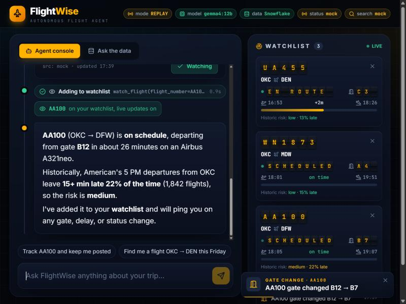

# FlightWise ✈️ — your autonomous flight agent

FlightWise finds flights, tracks them live, keeps watching them in the background, and tells you
**how likely each one is to be late**, using 1.8 million real US flights stored in **Snowflake**.
The AI is an **open-weight model running locally** through Ollama, so there is no paid AI API.

Built at the Hacklahoma mini hackathon (Hacktoberfest 2026) for *Best Open-Source AI Project* and
*Best Open-Source AI Project with Snowflake*.



## What it does
- **"Track AA100 and keep me posted"**: the agent looks up live status, checks historical delay odds
  for that airline, airport and hour, and adds the flight to a watchlist on its own. A background watcher
  then pushes gate changes, delays and departures to the page as they happen.
- **"Find me a flight OKC → DEN this Friday"**: searches offers and scores each one by delay history,
  price and stops. It recommends the most reliable good option, not just the cheapest.
- **"When's the best time to fly out of OKC?"**: text-to-SQL. The model writes SQL, a guardrail checks it,
  Snowflake runs it, and you get a plain-English answer with a chart and the SQL.

## Architecture
```
React + Tailwind UI ──SSE──► FastAPI ──► Agent loop (gemma4:12b via Ollama, tool calling)
   agent timeline            /api/chat      ├─ search_flights ─► SerpApi Google Flights  (mock fallback)
   watchlist (live)          /api/events    ├─ track_flight   ─► AeroDataBox live status (mock fallback)
   ask-the-data tabs         /api/ask       ├─ delay_risk     ─► Snowflake: BTS on-time history
                                            ├─ query_delay_history ─► NL → SQL → guard → Snowflake → explain
                                            └─ watch_flight   ─► Watcher (polls, diffs, pushes WatchEvents)
```
| module | job |
|---|---|
| `backend/flightwise/agent.py` | tool-calling loop, date resolution, local-time conversion, deterministic offer ranking, streamed answers |
| `backend/flightwise/data/` | `db.py` (Snowflake, or DuckDB offline), `guard.py` (single SELECT, LIMIT 500, via sqlglot), `nl2sql.py` (prompt + 1 retry + chart + explain), `examples.py` (few-shot SQL) |
| `backend/flightwise/providers/` | live status and search APIs, plus time-evolving mocks so the demo works without Wi-Fi |
| `backend/flightwise/watcher.py` | background flight watcher with fan-out to every open browser |
| `backend/flightwise/api.py` | REST + Server-Sent Events, demo cache fallback |
| `frontend/` | Vite + React 19 + Tailwind 4: split-flap departure-board UI, route arcs, risk gauges, charts |

Design choices: every external dependency has a fallback (live API → mock, Snowflake → DuckDB,
LLM → cached demo answers). Generated SQL is never trusted: it is parsed, limited to one SELECT on
`FLIGHTS`, and capped. Delay risk and offer ranking are plain SQL and code, not LLM guesses, so the
numbers are reproducible and the SQL is shown in the UI.

## Dataset
US DOT / BTS *Reporting Carrier On-Time Performance*, June–August 2026: 1,839,302 flights, 12 carriers.
`backend/scripts/fetch_bts.py` downloads it and slims it to 23 columns. Delay risk is the share of
departures delayed 15+ minutes for the same carrier, origin and local departure hour.
If that sample has fewer than 30 flights, it widens to carrier and origin.

## How Snowflake Cortex Code (CoCo) helped
<!-- TODO: add CoCo screenshots to docs/ and one line on what CoCo did for you -->
We used CoCo in Snowsight to profile the `FLIGHTS` table (columns, date range, gaps) and to draft
and test the example queries the model uses as few-shot prompts.

## Run it
Prereqs: Python 3.11+, Node 22+, [Ollama](https://ollama.com) with `ollama pull gemma4:12b`.
```bash
pip install -r requirements.txt
cp .env.example .env                     # add keys; leave blank to use mocks and DuckDB
python backend/scripts/fetch_bts.py      # ~90 MB download -> data/flights.parquet
python backend/scripts/load_snowflake.py # optional: load into Snowflake (needs SNOWFLAKE_* in .env)
cd frontend && npm install && cd ..
powershell scripts/dev.ps1               # API on :8000, UI on http://localhost:5173
```
Offline demo replay: `http://localhost:5173/?mock=1`. Backend tests: `cd backend && python -m pytest tests`.

## Models
`gemma4:12b` (Google Gemma 4, open weights) through Ollama, used for tool calling, SQL generation
(JSON-schema structured output) and explanations. Nothing is sent to a hosted AI API.

## License
MIT
